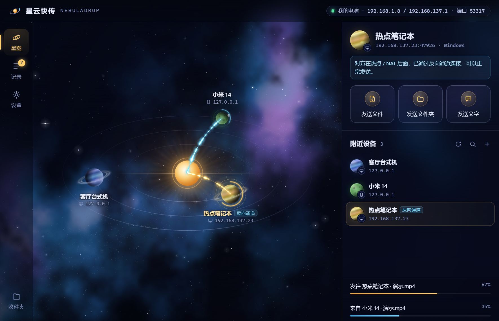
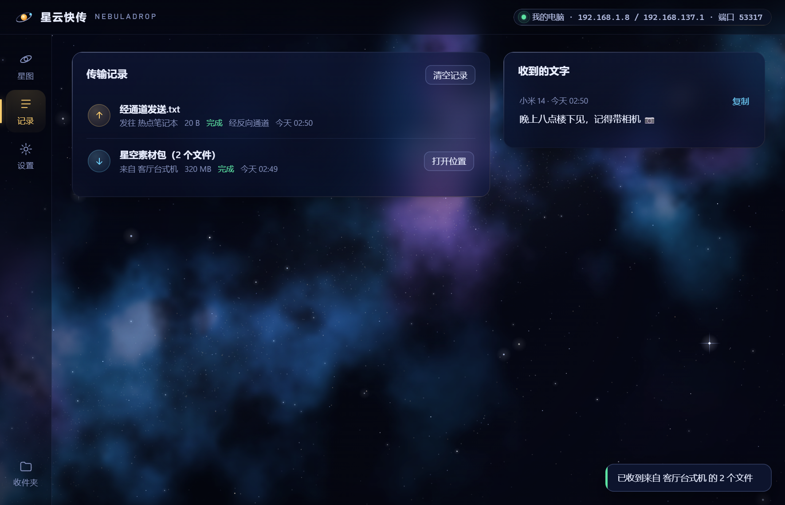

# 星云快传 NebulaDrop

局域网文件快传工具，星空主题界面。兼容 [LocalSend](https://github.com/localsend/localsend) 协议 v2，可以和手机、电脑上的 LocalSend 互相收发文件和文字。

**单个 exe，约 1.4 MB**，免安装，双击即用。



> 截图为本机模拟设备演示：设备名、IP 与“进行中”的两条传输均为示例。

## 和 LocalSend 相比改了什么

| 痛点 | NebulaDrop 的做法 |
| --- | --- |
| 收到文件后还得自己去找保存位置 | 接收完成后**自动打开资源管理器并选中文件**（文件夹则选中顶层文件夹）。可在设置里关闭；记录页每条都有“打开位置”。 |
| 界面简陋 | 星空主题：程序生成的体积星云与银河带、带光晕和衍射芒的亮星、流星；你的电脑是中央恒星，附近设备是轨道上的行星（电脑是带环的气态巨行星，手机是带卫星的岩石行星），明暗随恒星方向实时变化；传输时彗星粒子沿航线飞行，行星外圈显示进度。 |
| 电脑 A 开热点给 B 上网，C 与 A 在同一路由器下：B 能发给 C，C 却发不给 B | 自动识别 NAT，改走**反向通道**（详见下文）。 |
| 安装包近 100 MB | 改用 Windows 自带的 .NET Framework 4.8 与 WebView2（Edge 内核），程序本身只有约 1.4 MB。 |

## 热点 / NAT 场景为什么会出错，怎么修的

拓扑：A 同时连着路由器（如 `192.168.1.x`）并开了移动热点（`192.168.137.x`）；B 连 A 的热点；C 和 A 在同一路由器下。

- LocalSend 把对端地址记为 `/register` 请求的**来源 IP**。B 发往 C 的请求经过 Windows 热点的 NAT，来源被改写成 **A 的地址**，于是 C 把 B 记成了 A 的 IP。
- C 往“B”发送时实际连到了 A，证书指纹对不上，于是报错；而 B→C 是 B 主动出站，NAT 放行，所以反过来正常。
- C 本身也没有到 `192.168.137.x` 的路由，就算拿到 B 的真实地址也连不上。

NebulaDrop 的处理：

1. **公告自身全部 IP**：发现报文里附带 `ips` 字段。来源 IP 不在对方公告列表里，就判定对方在 NAT 后面，不再把网关地址当成对方。
2. **发送前核对身份**：直接比对 TLS 证书指纹，地址上实际是另一台设备时拒绝发送并说明原因，不会误发给 A。
3. **反向通道**：B 发现“对方看到的我的地址不是我自己的 IP”时，主动向 C 保持一条长轮询连接。C 要发文件时经通道下发邀约，由 B 主动拉取文件，全程只需要 B→C 方向可达。
4. **设备互换**：A 同时认识两边的设备，会把它们互相介绍，B 和 C 不必手动输入 IP 也能互相发现。

反向通道需要双方都运行 NebulaDrop；原版 LocalSend 设备之间的这种场景仍受其自身限制，但 NebulaDrop 至少会给出明确提示而不是误发。

## 功能

- 发送文件、整个文件夹（保留目录结构）、文字；拖放文件到行星上即发送
- 接收确认弹窗、自动接收、接收 PIN、同名文件自动改名、可选 SHA-256 校验、先写临时文件再改名（不留半截文件）
- 发现：UDP 组播（224.0.0.167:53317）+ HTTPS 注册握手 + 网段扫描 + 手动输入 IP
- HTTPS 双向证书：每台设备首次启动生成自签证书，设备指纹即证书 SHA-256，与 LocalSend 一致
- 端口 53317 被占用（例如 LocalSend 正在运行）时自动顺延
- 关闭窗口最小化到托盘、系统通知、传输记录与文字消息历史



## 下载与运行

到 [Releases](../../releases) 下载 `NebulaDrop-x.y.z.exe`，放在任意位置双击运行。

- 系统要求：Windows 10 1903 及以上或 Windows 11（自带 .NET Framework 4.8 与 WebView2 运行时；极少数 Windows 10 缺 WebView2 时程序会提示下载）。
- 首次运行时 Windows 防火墙会询问是否允许网络访问，请勾选“专用网络”并允许，否则其他设备连不进来。
- 程序未做代码签名，SmartScreen 可能提示“未知发布者”。
- 设置、历史与设备证书保存在 `%APPDATA%\NebulaDrop`，WebView2 缓存在 `%LOCALAPPDATA%\NebulaDrop`。

## 从源码构建

```powershell
dotnet build desktop -c Release      # 产物：desktop\bin\Release\net48\NebulaDrop.exe（单文件，可单独拷走）
npm install                          # 仅参考实现与开发脚本需要
npm test                             # 传输核心集成测试（直连、反向通道、身份核对、拒收、路径清洗）
```

需要 .NET SDK（任意较新版本均可构建 net48 目标）与 Node.js 20+。

目录：

```
desktop/          桌面端：C# (.NET Framework 4.8) + WebView2
  Core/           传输核心：发现、收发、反向通道、设备互换
  Net/            自写的 HTTPS 服务端与客户端（SslStream，双向证书）
  App/            窗口、托盘、通知、消息桥、自动打开文件位置
web/              界面：星空背景、星图、记录、设置（嵌入 exe）
reference/        Node 协议参考实现、集成测试与模拟设备，用于互通测试
scripts/          图标生成
```

开发时可设置环境变量 `NEBULA_WEB_DIR=<web 目录绝对路径>`，让桌面端直接加载磁盘上的界面文件，改完刷新即可，无需重新编译。

## 协议兼容说明

- 实现 LocalSend Protocol v2 的 `/register`、`/info`、`/prepare-upload`、`/upload`、`/cancel`，文字消息按 LocalSend 约定（`text/plain` + `preview`）收发。
- 扩展字段（`ips`、`nebula`、`observedIp`）对 LocalSend 透明；扩展接口位于 `/api/nebula/v1/*`（`peers`、`tunnel`、`pull`、`offer-result`）。
- 已在 Windows 上与 LocalSend 1.18.2 验证 HTTPS 双向证书握手与 `/register`；桌面端服务端已验证 TLS 1.3（仅 RSA-PSS 签名）与 TLS 1.2 客户端证书握手。
- 出站连接固定 TLS 1.2：.NET Framework 导入的私钥位于旧式 CryptoAPI，无法完成 TLS 1.3 要求的 RSA-PSS 客户端签名。

## 许可与致谢

Apache License 2.0。协议设计来自 LocalSend 项目；NebulaDrop 是独立实现，与 LocalSend 官方无关联。
